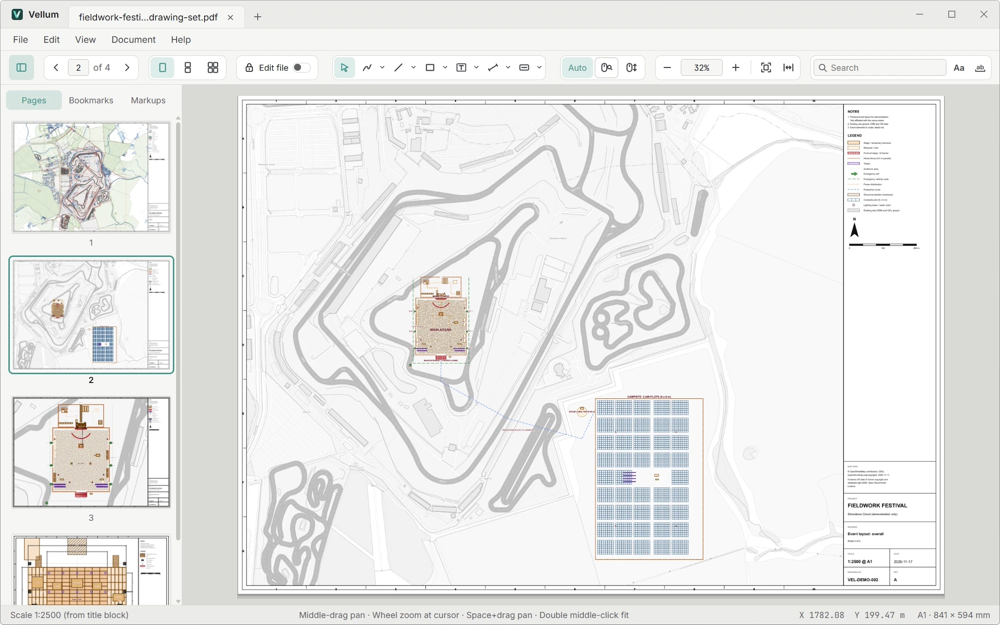

<p align="center">
  
</p>

<h1 align="center">Vellum</h1>

<p align="center">
  <strong>A fast PDF and image viewer for people who open drawings, not documents.</strong>
</p>

<p align="center">
  <a href="https://github.com/canoemoose/Vellum/releases/latest"></a>
  <a href="https://github.com/canoemoose/Vellum/releases"></a>
  
  <a href="LICENSE"></a>
  <br>
  
  
  
  
</p>

<p align="center">
  <a href="https://github.com/canoemoose/Vellum/releases/latest"><strong>Download</strong></a> ·
  <a href="https://canoemoose.github.io/Vellum/">Homepage</a> ·
  <a href="https://github.com/canoemoose/Vellum/releases">Release notes</a>
</p>

<picture>
  <source media="(prefers-color-scheme: dark)" srcset="site/img/hero-dark.webp">
  
</picture>

<sub>The screenshot is the fictional Fieldwork Festival drawing set. Map data © OpenStreetMap
contributors (ODbL). Contains OS data © Crown copyright and database right 2026 (Open
Government Licence).</sub>

Stage plans, rigging plots, site layouts, sixty-year-old scanned blueprints: the files that
make ordinary PDF readers sit and think. Vellum opens them fast, zooms where your cursor is,
measures in real-world units and prints at the scale you asked for.

## Why it's nice

- ⚡ **Quick on big drawings.** Tiled rendering, previews cached on disk, and sharp 16 ms
  after you stop zooming (one wheel notch, typical drawings).
- 🖱️ **Moves like CAD.** Wheel zooms at the cursor, middle-drag pans, double middle-click
  fits. Office documents scroll like documents instead; **N** swaps.
- 📏 **Real-world scale.** Each sheet's scale read from its own title block, metric or
  imperial. Length, area and angle, dimensions, calibration.
- ✏️ **Markup, stamps and signatures.** Clouds, arrows, shapes, text, pen and highlighter,
  saved as standard PDF annotations that Acrobat and Edge read.
- 🖨️ **Prints to scale.** Fit, actual size, a real ratio like 1:200, or tiled with cut marks.
  Lay crops out by hand across sheets. Black lines cleans up grubby scans.
- 🖼️ **Images too.** JPEG, PNG, WebP, TIFF, BMP and GIF, colour profiles and all.

## What it isn't (yet)

- **Cross-platform.** Windows only: printing talks to GDI and the printer driver directly.
- **A page editor.** No inserting, deleting or reordering pages, and no forms. Both on the list.
- **OCR.** Drawings whose text was exploded into outlines can't be searched or have their scale
  read. On the list.

## Install

Grab the installer from the [latest release](https://github.com/canoemoose/Vellum/releases/latest).
It isn't code signed, so SmartScreen warns the first time: **More info**, then **Run anyway**.

After that it keeps itself up to date: one check a day at start-up, a small notice when there's
a new version, and nothing downloads until you say so. The check sends nothing about you or
your files. Help menu to turn it off.

## Keys worth knowing

| | |
|---|---|
| Zoom at cursor | Wheel (CAD) / Ctrl+wheel (Document) |
| Pan | Middle-drag, or Space+drag |
| Fit page / fit width / actual size | Ctrl+0 / Ctrl+2 / Ctrl+1 |
| Switch navigation mode | N |
| Rotate view | ] / [ |
| Measure | D |
| Markup | A, L, R, E, G, C, P, H, T, S, I |
| Print | Ctrl+P |
| **Everything else** | **F1** |

## Build it

Once: [Volta](https://volta.sh) (Node versions are pinned in `package.json`),
[Rust](https://rustup.rs), and the Microsoft C++ Build Tools with **Desktop development with
C++**. Tauri's [prerequisites](https://tauri.app/start/prerequisites/) have the long version.

```bash
npm install
npm run tauri dev
```

`pdfium.dll` downloads itself on the first run. `npm run tauri build -- --no-bundle` makes a
release exe; installers are built and signed by GitHub Actions from a version tag (see
Releasing in [CLAUDE.md](CLAUDE.md)).

```bash
npm test                    # Vitest: navigation maths, print model, markup, settings
npm run check               # svelte-check, strict
cd src-tauri && cargo test  # Rust: rendering, cache, print composition, a real print to PDF
```

## How it's built

- **`src-tauri/`** (Rust): PDFium on a worker pool, tile rendering, the disk cache, colour
  profiles, PDF annotations and saving, print composition and GDI printing.
- **`src/lib/engine`, `render`, `view`** (TypeScript, no Svelte): the viewer, tile scheduling,
  input and navigation maths. Pure and tested.
- **`src/lib/print`, `src/lib/markup`** (TypeScript): the print and markup models, as pure
  functions.
- **`src/`** (Svelte 5): the shell. Components call into the engine, never the other way round.

More: [ARCHITECTURE.md](ARCHITECTURE.md) for how it works,
[RESULTS.md](RESULTS.md) for why PDFium,
[docs/speed-handoff.md](docs/speed-handoff.md) for speed work and how it's measured, and
[CLAUDE.md](CLAUDE.md) for every command.

## Licence

[MIT](LICENSE). Vellum ships PDFium and a few hundred open-source crates and packages; their
notices are collected into `THIRD-PARTY-NOTICES.txt`, which the installer puts beside the exe
and Help > About opens.
